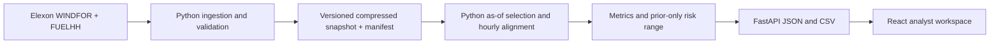

# Technical review guide

## Main path

React never recalculates the statistical metrics. It formats MW to GW and MWh to GWh, controls chart visibility, and presents rows. The Python API is also independently inspectable with OpenAPI.

## Selection and temporal correctness

Read `WindData.latest`, then `WindData.day`, then `day_analysis` in `backend/analysis.py`.

The index maps target timestamp to sorted `(publication, generation)` versions. A binary search selects the last version at or before cutoff, independently for every target. A late forecast does not replace the historical selection. A missing target remains null.

Hourly actuals require complete adjacent `:00` and `:30` records and average their MW. Latest actual revisions are used for retrospective evaluation. The pilot treats hourly forecast samples as representative hourly means. This is a documented convention, not a transformation that manufactures half-hourly forecast precision.

The risk history includes only earlier January decision rows with finished delivery hours and actual publication timestamps at or before the present cutoff. Full-month results never inform that history. With fewer than 48 paired hours, the range and P90 desk estimate are withheld. Cutoffs late in a day can use completed hours from that same calendar day if those forecasts came from an earlier buying decision.

## Why a snapshot, not a database

The brief fixes a single month and two public datasets. A database, account system, job queue, live polling service, or AI forecast service would add complexity without changing the required pilot. A checked-in gzip file preserves the original records and is small enough for Vercel serverless and Docker. The separate manifest supports audit and replacement.

Ingestion has three concurrent requests at most, bounded retries with exponential delay on transient/network failures, response validation, deterministic record deduplication, and atomic snapshot replacement after all downloads succeed. A new deployment restarts process caches. Never refresh files under a running process and expect cached data to change.

## Delivery

Vite development proxies same-origin `/api` requests to Python. The Docker image builds React with Node 22, then copies the built assets into a Python 3.12 image. FastAPI serves both the assets and API on port 8000, under a non-root user. Vercel's static hosting serves the frontend; its Python function imports the identical FastAPI app. The snapshot is packaged with the function. No secrets, tokens, database migrations, or external services are needed at runtime.

## UI choices

The desk distinguishes information available at the decision from later actuals. Hindsight is opt-in and labelled. Supporting sources, exact tabular values, lead times, cutoffs and scope are visible. SVG charts have textual summaries and equivalent tables. Controls have explicit labels, keyboard focus indicators, and native form validation. Layout stacks on mobile; tables scroll within their own region. Reduced motion is respected. Failed requests show an actionable retry and do not preserve stale results under new date labels.

## Deliberate limits

The range is a pooled, descriptive sample across delivery hours and forecast horizons. It is not a calibrated, conditional uncertainty model. Only January decision history is used, so no mature estimate exists at the start of the window. An operational version would require agreed source coverage, archived revisions, more training months, proper out-of-sample calibration, and utility demand/contracts. The current pilot makes none of those assumptions silently.

Read `tests/test_analysis.py` for temporal invariants, hand-computed metric cases, missing data, validation, and a direct raw-input cross-check. CI verifies an independently built Docker runtime as well as the Python and TypeScript builds.
